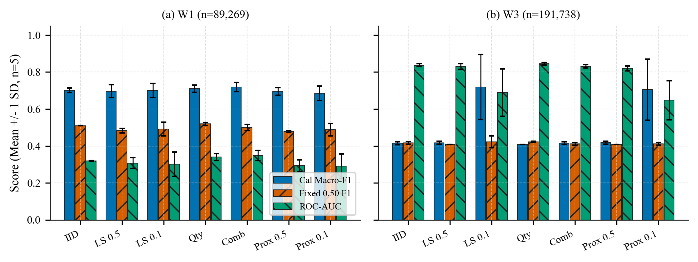
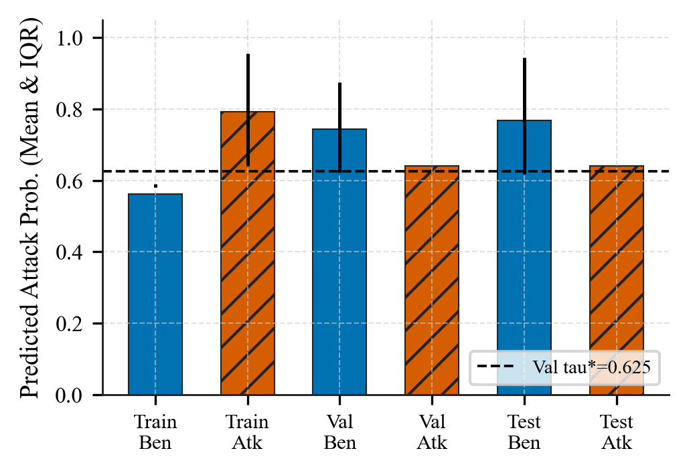
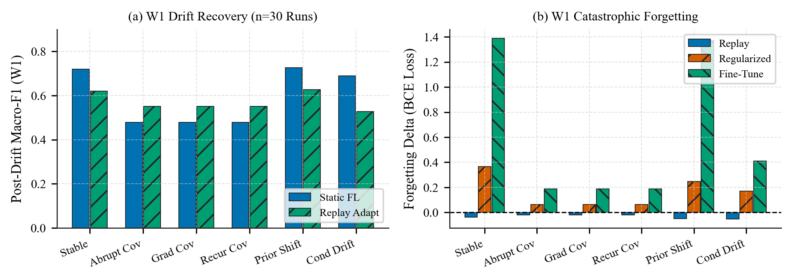
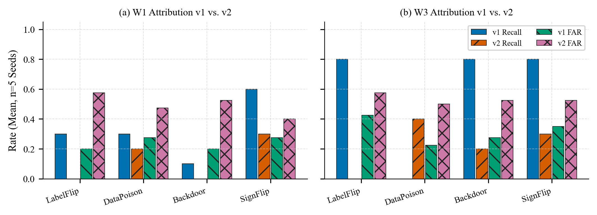
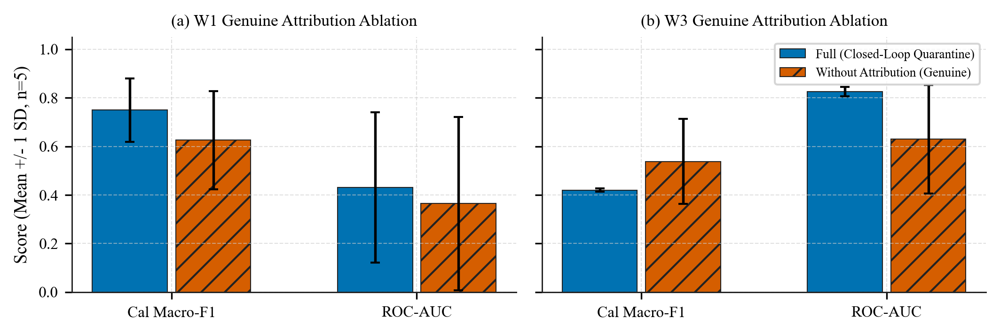

# Phase 3B.2 Results Figure Catalog (`FIG-10_phase3b2_results`)

All 5 PNG files in `docs/results/figures/` are **separate documentation presentation copies** of the verified Phase 3B.2 IEEE figures. Canonical publication bundles (`.pdf`, `.eps`, `300+ DPI .png`, `_data.csv`, `_data.json`, `_caption.txt`, `_metadata.json`, and `plot_phase3b_2_revised_figures.py`) remain preserved untouched outside Git under `<DAFIDAF_RUNS_ROOT>/phase3b_2/figures/`. Original Phase 3B figures under `<DAFIDAF_RUNS_ROOT>/figures/phase3b/` also remain untouched.

---

## Verified Measured Figures Inventory

| Catalog ID | File (`docs/results/figures/`) | Version | Component | Provenance | Verification Status |
| --- | --- | --- | --- | --- | --- |
| `FIG-10a` | `fig_E1_02_f1_comparison_rev2.png` | Rev. 2 | E1 Heterogeneity | `70` E1 runs (`n=5` seeds) on overlapping W1 (`n=89,269`) & W3 (`n=191,738`) | **VERIFIED (Measured)** |
| `FIG-10b` | `fig_E1_03_w1_domain_shift.png` | v1 (3B.2) | E1 W1 Diagnostics | Saved checkpoint `e1_W1_iid_fedavg_seed42/checkpoint_round_008.json` | **VERIFIED (Measured)** |
| `FIG-10c` | `fig_E2_01_drift_timeline_rev2.png` | Rev. 2 | E2 Drift Adaptation | `30` plotted W1 runs (`is_synthetic=True`, `n=5` seeds, Non-DP) | **VERIFIED (Measured, Synthetic Drift)** |
| `FIG-10d` | `fig_E3_02_attribution_v2.png` | v1 (3B.2) | E3 Attribution v1 vs v2 | `40` E3 v2 runs vs Phase 3B v1 across 4 attack arms (`n=5` seeds, Non-DP) | **VERIFIED (Measured — Negative Net Result)** |
| `FIG-10e` | `fig_E6_02_genuine_ablation.png` | v1 (3B.2) | E6 Closed-Loop Ablation | `20` E6 v2 matched-seed runs (`sign_flip`, `f=2/10`, `FedAvg`, Non-DP) | **VERIFIED (Measured — Over-Quarantine Disclosed)** |

---

## Figure Previews and Captions

### `FIG-10a` — E1 Heterogeneity Comparison (Rev. 2)

**Caption:** Fig. E1-02 (Rev. 2 — Metadata Corrected): Val-calibrated Macro-F1, fixed 0.50 F1, and ROC-AUC across all 7 E1 configs (`70` runs total; `n=5` seeds) on separate overlapping windows (a) W1 (`Shards 22+23`, `n=89,269`) and (b) W3 (`Shards 8–23`, `n=191,738`; $\text{W1} \subset \text{W3}$).

---

### `FIG-10b` — E1 W1 Domain-Shift & Score-Inversion Diagnostics

**Caption:** Fig. E1-03 (Workstream A Diagnostic): Predicted attack probability mean and IQR (25th–75th pct) from saved W1 `iid_fedavg` seed-42 checkpoint across Train (`xss`-heavy), Val (`backdoor`), and Test (`backdoor` + `mitm`). Test benign mean (`0.769`) exceeds Test attack mean (`0.641`), explaining `ROC-AUC = 0.3208` while `29.2%` benign `< 0.625` yields `Macro-F1 = 0.699`.

---

### `FIG-10c` — E2 Controlled Drift Intervention Timeline (Rev. 2)

**Caption:** Fig. E2-01 (Rev. 2 — Metadata Aligned to Plotted W1 Runs): Controlled synthetic drift interventions (`is_synthetic=True`) on W1 (`30` runs; `n=5` seeds, Non-DP baseline).

---

### `FIG-10d` — E3 Attribution v1 vs. v2 Comparison (Workstream B)

**Caption:** Fig. E3-02 (Workstream B Remediation): Original E3 (v1) vs. clean-validation-probed E3 (v2) Malicious Recall and False Attribution Rate (FAR) across 4 attack arms on (a) W1 (`n=89,269`) and (b) W3 (`n=191,738`; overlapping, not pooled; `n=5` seeds, Non-DP). Demonstrates W3 `data_poisoning` recall gain (`0.00 -> 0.40`) accompanied by severe FAR regression (`0.400–0.575`).

---

### `FIG-10e` — E6 Genuine Closed-Loop Attribution Ablation (Workstream C)

**Caption:** Fig. E6-02 (Workstream C Remediation): Genuine closed-loop attribution quarantine vs. verified zero-call `without_attribution_genuine` ablation under `sign_flip` attack (`f=2/10`, `FedAvg`, `n=5` seeds, Non-DP) on (a) W1 (`n=89,269`) and (b) W3 (`n=191,738`).
