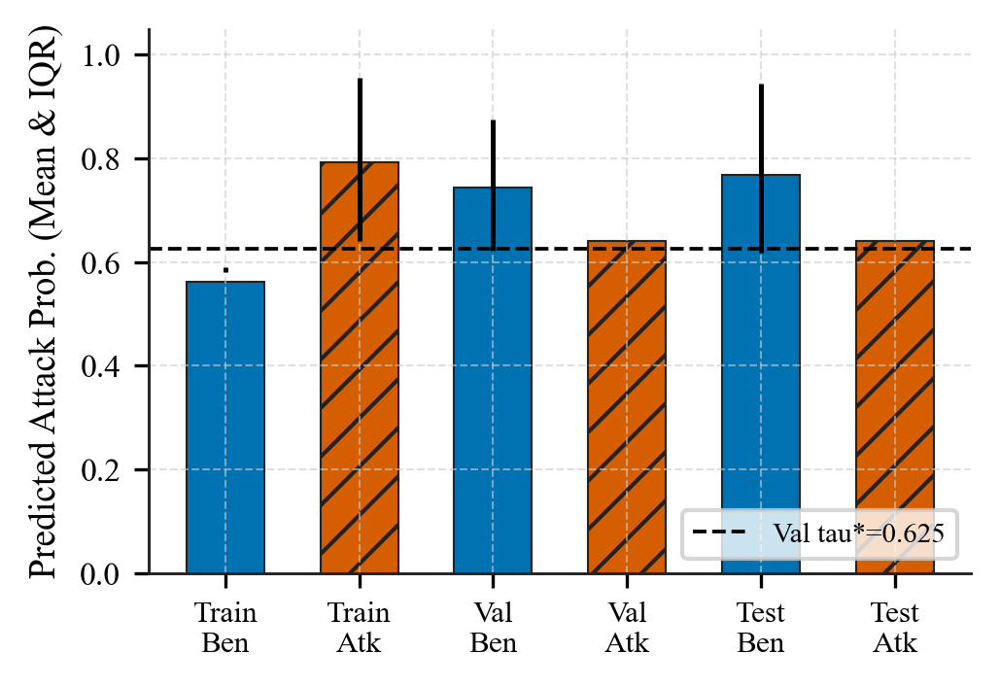
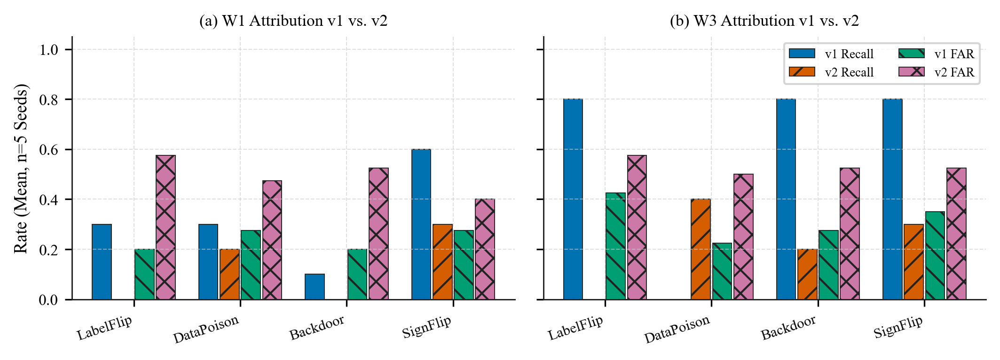

# Experimental Results Overview (Phase 3B & Phase 3B.2)

!!! info "Reporting Integrity Notice"
    All numbers on this page are measured directly from verified Phase 3B (`490` runs) and Phase 3B.2 (`60` runs) artifacts (`Non-DP baseline only`, `LinearLogisticIDS`, `K=10` simulated logical gateways, `n=5` seeds `[42, 101, 202, 303, 404]`).
    **ToN-IoT windows W1 (`n=89,269`) and W3 (`n=191,738`) overlap ($\text{W1} \subset \text{W3}$) and are never pooled as independent datasets.**

---

## Summary of Key Verified Findings

| Experiment | Scope & Setting | Verified Outcome | Key Caveat / Status |
| --- | --- | --- | --- |
| **E1 (Heterogeneity & Domain Shift)** | `70` runs across `7` Non-IID / `FedAvg` / `FedProx` configs on W1 & W3 | W1 `iid_fedavg` (`seed=42`): `Train AUC = 0.933945 -> Val AUC = 0.333538 -> Test AUC = 0.320810` (`8/8` active features sign-inverted between `xss` Train and `backdoor` Test). W3 `seed=42`: `Train AUC = 0.8744 -> Test AUC = 0.8321`. | Linear hyperplane cannot separate opposing attack clusters (`GAP-02`). |
| **E2 (Concept Drift & Replay)** | `30` plotted W1 runs (`is_synthetic=True`) + embargo checks (`300s`/`900s`) | Controlled synthetic gradual/abrupt drift detected and evaluated with replay adaptation. | Controlled synthetic drift; round-8 evaluation limit (`GAP-07`). |
| **E3 (Benign Drift vs. Poisoning Attribution)** | `40` new Phase 3B.2 v2 runs vs. Phase 3B v1 across `4` attack arms | v2 (`client_val_loss_delta`) improved W3 `data_poisoning` recall (`0.000 -> 0.400`), **but severely regressed FAR (`0.400–0.575`)** and flagged `4–8/15` benign-drifted clients. | **Negative net remediation — DO NOT deploy v2 as default** (`GAP-03`). |
| **E4 (Byzantine-Robust Aggregation)** | `FedAvg`, `Coordinate Median`, `Trimmed Mean`, `Multi-Krum` on W1 & W3 | Robust aggregators mitigated non-adaptive `sign_flip` relative to `FedAvg`, though W3 `Multi-Krum vs FedAvg` AUC gain (`+0.1669`) lost significance under exact Student-$t$ ($df=4$, CI `[-0.0827, +0.4166]`). | Adaptive attacks (ALIE/Min-Max) not yet evaluated (`GAP-07`). |
| **E5 (Cross-Dataset Generalization)** | ToN-IoT / CICIoT2023 / Edge-IIoTset | **NOT EXECUTED (`HOLD`)** | Blocked pending validated semantic ontology (`GAP-05`). |
| **E6 (Closed-Loop Attribution Ablation)** | `20` matched-seed runs (`sign_flip`, `f=2/10`, `FedAvg`) | W1 Macro-F1: `0.6256 -> 0.7493` (`+0.1237`); W3 ROC-AUC: `0.6294 -> 0.8257` (`+0.1963`). Code isolation verified (`0` vs `6` attribution calls). | Over-quarantined `41%–45%` client-rounds (`2–3` honest clients/round); W3 AUC gain not significant under exact $t_4$ CI (`[-0.0726, +0.4653]`). |

---

## Highlighted Phase 3B.2 Diagnostic Figures

*Figure 1 (`FIG-10b` / `fig_E1_03_w1_domain_shift`): Predicted attack probability mean and IQR (25th–75th pct) from the saved W1 `iid_fedavg` seed-42 checkpoint across Train (`xss`-heavy), Val (`backdoor`), and Test (`backdoor` + `mitm`).*

*Figure 2 (`FIG-10d` / `fig_E3_02_attribution_v2`): Original E3 (v1) vs. experimental clean-validation-probed E3 (v2) Malicious Recall and False Attribution Rate across 4 attack arms on overlapping windows W1 and W3 (`n=5` seeds, Non-DP).*

See [Results Figure Catalog](figures/FIGURE_CATALOG.md) for all 5 verified Phase 3B.2 preview figures, complete captions, and provenance metadata.
